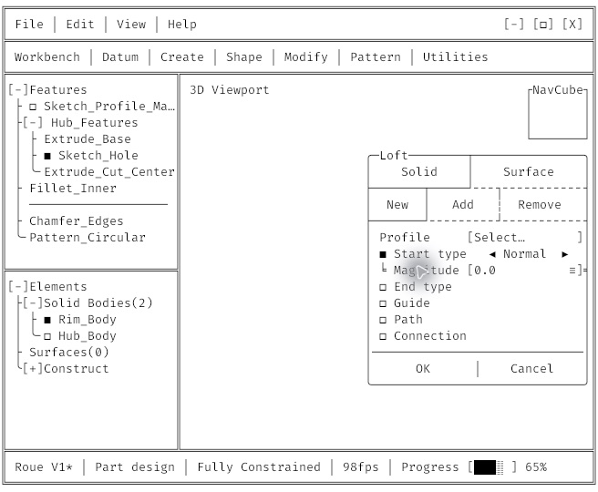

# M2 application visual validation — 2026-10-16

## Environment and scope

Tested the ASCII application built directly from this repository after commit
`d429c52`, with `cargo build -p newell-app --locked`. A temporary macOS bundle
outside the repository made this exact executable identifiable to the visual
control tool; no production source was changed for the inspection.

Startup enumerated a 2940 × 1912 Retina display at scale factor 2 and a
1920 × 1080 external display at scale factor 1. The actual inspected window
started on the external display. Runtime diagnostics reported preference 100%,
reference/effective `k = 2`, 8 × 18 physical-pixel cells, and a minimum window
of 656 × 540 pixels (82 × 30 cells).

## Observed results

| Criterion | Result and evidence |
|---|---|
| M2.16 monochrome typography | PASS on Full HD: readable text, continuous inspected frames/branches, no colour or state tint; both Light and Dark inspected. Existing atlas/GPU tests cover all supported k values. Retina appearance was not observed. |
| M2.17 initial frameless/minimum window | PASS: no persistent native title bar, complete 82 × 30 shell visible at 656 × 540. |
| M2.17 maximise/restore | PASS: window enlarged to 1920 × 1080; frame, chrome and Action Box remained aligned, then restored to 656 × 540. |
| M2.17 fullscreen | PASS: View > Fullscreen entered and exited; the frameless appearance returned after the OS transition completed. |
| M2.17 minimise/restore command | Invoked the ASCII minimise control and then raised the window through accessibility; the restored shell preserved its contents. Intermediate minimised state was not independently captured. |
| M2.17 native edges/multi-monitor | NOT CONFIRMED: automated drag attempts did not produce a verifiable size or monitor change. This does not establish whether the native gesture path or automation caused the lack of movement. The eight-zone and Retina/Full-HD round-trip checklist remains open. |
| M2.18 themes | PASS: View > Theme changed Light to Dark and back; layout and text remained aligned. |
| M2.18 scale preferences | PASS on Full HD: 100 → 120 → 60 → 80 → 100 displayed correctly. All map to k=2 as specified. Cross-monitor preservation and actual k transitions were not visually verified. |
| M2.24 live FPS | FAIL: status remained 98fps across interactions. `shell/data.rs` defines a fixed `FPS = 98`. |
| M2.24 progress | FAIL: status remained 65%, including after clicking the segment. `shell/data.rs` defines fixed `PROGRESS = 65`; no animation started. |
| M2.24 redraw scheduling | FAIL on source inspection: `app.rs` still constructs the 60 FPS FramePacer and schedules its wakeups. The required independent 5 Hz FPS refresh and progress deadlines are absent. |
| M2.25 parameter hover | PASS for inspected Profile label, expanded Loft Start type, cyclic-row regions and Magnitude label. Only border slots changed; moving to another row restored the previous slots. |
| M2.25 header hover | PASS for inspected Surface segment and existing header controls: only the segment's boundaries changed, with the active horizontal topology preserved. Automated tests cover all five Action Boxes and header ids. |
| M2.25 precedence/state | The View popup covered the underlying shell; closing it restored the shell. Sampled pointer interactions preserved UI-only state and text. Exhaustive precedence and no-acquisition behavior remain covered by tests. |

## Acceptance decisions

- M2.16: accepted locally based on both-theme visual inspection and existing
  all-k atlas/GPU checks. This is not a claim of Retina visual inspection.
- M2.17 and M2.18: partially verified; keep unchecked until the real monitor
  round-trip and complete native resize checklist are confirmed.
- M2.24: incomplete implementation, not merely missing visual acceptance.
- M2.25: sampled visual behavior passes, but the plan explicitly depends on
  M2.24's event-driven scheduling, which is absent. Keep final milestone
  acceptance open and record the verified hover feature separately.

The prior automated report incorrectly attributed dynamic FPS/progress tests
to M2.24. The actual tests cover reference progress glyphs and bootstrap
pacing; they do not test the missing M2.24 runtime behavior. That report and
the plan/backlog status have been corrected. No runtime implementation was
changed during this validation-only task.

## Captured evidence

