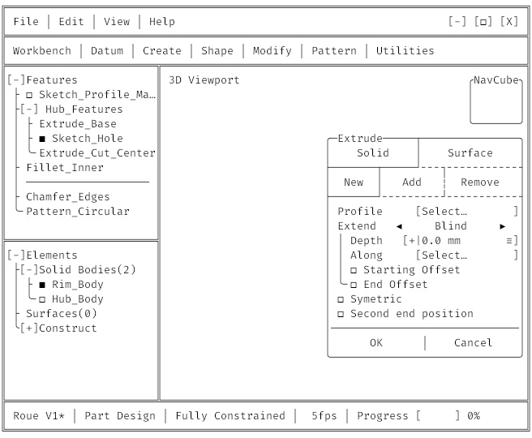
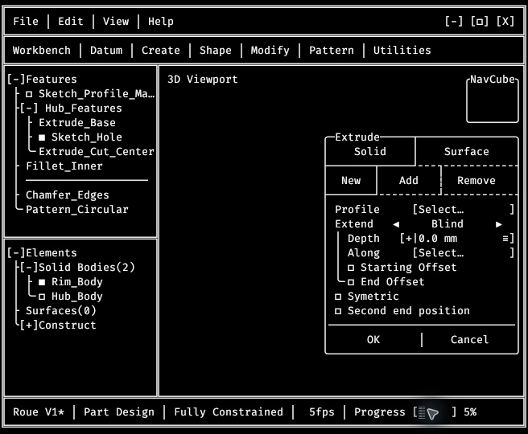
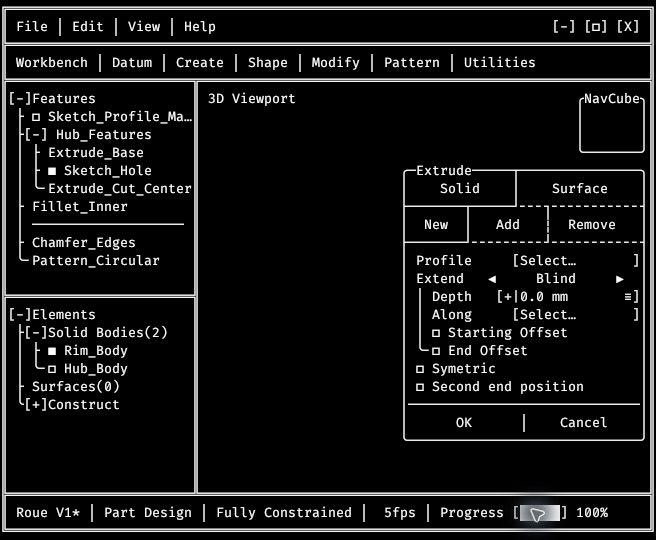

# M2.24 — Implementation and validation, 2026-10-16

## Result

M2.24 is implemented and validated locally in the current ASCII application.
Its scheduling prerequisite for M2.25 is satisfied. Native edge-resize and
cross-monitor acceptance for M2.17–M2.18 remains open and is not claimed here.

## Runtime behavior

- Count only `FrameOutcome::Presented`, not skipped surface frames or timer
  wakeups. The displayed rate is presentations divided by actual monotonic
  elapsed sample time, refreshed independently every 200 ms.
- Format FPS in exactly seven cells: three right-aligned digits, `fps`, one
  trailing blank. Round finite non-negative values, saturate at 999, and map
  negative/NaN/infinite inputs to zero.
- Start progress at 0%. The fixed 21-cell segment, including padding, has one
  stable WidgetId and no hover effect. Left-button press starts 0→100 in 5 s
  or 100→0 in 1 s. In-flight presses are ignored without queueing or restarting.
- Quantize elapsed nanoseconds with integer arithmetic, floor ascending and
  ceil descending. Endpoints are reached only at the exact duration. A delayed
  tick skips missed steps without changing the total duration.
- Wake at the minimum independent FPS/progress deadline (250 ms ascending
  steps, 50 ms descending); idle progress contributes no deadline. Existing
  monitor/scale-transition deadlines remain independent. Hidden windows do not
  schedule unseen status redraws; monotonic elapsed progress catches up after
  restoration.
- Retire FramePacer from the application loop. Its pure M1 helper and historical
  tests remain available, but the running application has no 60 FPS bootstrap.
- Preserve overlay consumption, resize-ring precedence, stable hit maps and
  the single GPU UI draw call. Full logical recomposition is retained as allowed
  by the plan; only status-cell contents change for status updates.

## Final fidelity

Pure composition receives explicit FPS/progress inputs. Snapshot helpers inject
98 FPS and 65%; runtime starts at zero and receives measurements.

The complete grid is compared cell-for-cell with Interface_Exemple.txt at
82×28 and 82×30 in both themes. The approved CommandBar supersession and the
normalization of the intentional row-19 hover state are the only comparison
exceptions. At 82×30 the two extra body rows equal the required blank template.

This comparison exposed two pre-existing differences: NavCube square corners
and the lower-case `Part design` status label. Production composition now uses
the reference rounded corners and `Part Design` status label; the Workbench
menu labels are unchanged. Snapshot updates were inspected and restricted to
those corner characters and that letter case. ASCII design references were
not rewritten to obtain a passing result.

## Automated verification

- 679 tests pass with `cargo nextest run --workspace --all-features --locked
  --no-tests=pass`; the eight default-skipped GPU tests pass separately.
- Fourteen new tests cover timing, quantization inequalities and exact
  multiples, skipped-frame equivalence, ignored in-flight clicks, actual-frame
  sampling, independent deadline phases, all 21 clickable cells, neighboring
  non-target cells, stable ids, menu click-through prevention, a non-dismissing
  FormulaEditor modal, resize-ring precedence, FPS formatting, unchanged
  non-status/FPS cells, all 21 reference strings and full-shell fidelity.
- Formatting, Clippy with warnings denied, Rust 1.85 workspace check,
  documentation with warnings denied, doctests and compilation pass.
- No changes to the renderer, shaders, atlas or dependency declarations.

## Application inspection

The repository-built executable was opened in the same temporary macOS
validation bundle as the earlier inspection, on the 1920×1080 external display
at k=2. The final build was inspected again after the fidelity corrections.

Observed:

- idle FPS settled around 5 rather than a fixed 98; the value changed during
  actual input/animation rendering;
- initial 0%, visible intermediate 5% increments, stable 100%, a faster return
  through intermediate values to 0%, and a repeatable cycle;
- a second press during ascent did not reset the displayed progression;
- an outside press on progress while File was open dismissed the menu and left
  progress at 0%; it did not start animation through the menu;
- Light and Dark layouts retained fixed separators, segment width and border
  positions. Final NavCube corners and status-label casing match the reference.

Exact sub-millisecond boundary assertions rely on the injected-clock tests;
manual screenshots are evidence of runtime behavior, not precision timing.

